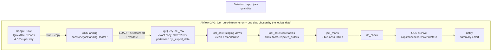

# QuickBite Data Platform (Joel)

A daily, incremental pipeline that brings QuickBite's CSV exports from Google Drive into BigQuery,
cleans them, applies the business rules and builds three mart tables for the analytics team.

**Stack:** Cloud Composer 3 (Airflow 2.11) · Cloud Storage · BigQuery · Dataform (core 3.0.52)

---

## 1. Architecture



Airflow orchestrates; BigQuery and Dataform do the data work.

### DAG tasks (per run)

| Order | Task(s) | What it does |
|---|---|---|
| 0 | `create_raw_tables` | `CREATE TABLE IF NOT EXISTS` for the 4 raw tables (explicit schema, partitioned). Safe on every run. |
| 1 | `wait_<file>` ×4 | `GoogleDriveFileExistenceSensor`, `mode="reschedule"`: waits for `<file>_{{ ds }}.csv`, freeing the worker slot between checks (5 min interval, 6 h timeout). |
| 2 | `copy_<file>` ×4 | `GoogleDriveToGCSOperator`: Drive → `landing/{{ ds }}/`. |
| 3 | `load_raw_<file>` ×4 | `LOAD DATA` into a scratch table, then **in one transaction** `DELETE` that day's partition and `INSERT` it with `_source_file`, `_export_date`, `_loaded_at`. Re-running a day replaces it: no duplicates. |
| 4 | `validate_raw_<file>` ×4 | Reconciliation: header = expected columns, file row count = raw row count for the day, label columns filled. `retries=0`. |
| 5 | `dataform_compile` | Compiles the Dataform repo's `main` branch. |
| 6 | `dataform_run` | Runs all Dataform actions + assertions and waits; fails if any action or assertion fails. |
| 7 | `dq_check` | `BigQueryCheckOperator`: one row per order in `fct_orders`; every distinct order received = valid + rejected; no negative revenue. |
| 8 | `archive_files` | `GCSToGCSOperator(move_object=True)`: `landing/{{ ds }}/` → `archive/{{ ds }}/`. |
| 9 | `notify` | `trigger_rule="all_done"`. Logs one summary line (delivered orders, revenue, rejected orders for the day). If anything failed it lists the failed tasks and fails, so the run shows red. |

DAG settings: `start_date=2026-10-10`, `schedule="@daily"`, `catchup=True` (creates the 10-10 … 10-13 runs),
`max_active_runs=1` (days are processed strictly in order), `retries=2` by default.

---

## 2. Loading strategy per table

| Layer | Table | Type | Strategy | Why |
|---|---|---|---|---|
| raw | `restaurants`, `customers`, `orders`, `order_items` | table | **Replace the day's partition** (delete + insert) | Keeps an exact, auditable copy of every file; re-runs are idempotent. |
| staging | `stg_restaurants` | view | n/a | Latest snapshot only (rule 3). |
| staging | `stg_customers`, `stg_orders`, `stg_order_items` | view | n/a | Clean every version; no data copied. |
| core | `dim_restaurants` | table | **Replace** | The file is a full snapshot every day, so the latest snapshot is the truth. Inactive restaurants are kept. |
| core | `dim_customers` | incremental, `uniqueKey: customer_id` | **Upsert (merge)** | The file carries new sign-ups and changed customers. Latest `updated_at` wins. |
| core | `fct_orders` | incremental, `uniqueKey: order_id` | **Upsert (merge)**, incremental | The file carries new orders and status changes. Latest `updated_at` wins. Partitioned by `order_date`, clustered by `restaurant_id, customer_id`. |
| core | `fct_order_items` | incremental, no key | **Append** (insert-only, skip existing `order_id + line_no`) | Items never change once placed, so nothing is ever updated. Skipping existing keys makes re-runs safe. |
| core | `rejected_orders` | table | Replace | Small; rebuilt from the latest version of every order. |
| core | `order_revenue` | view | n/a | Revenue per order (rule 6), shared by all marts. |
| marts | `mart_daily_city_revenue`, `mart_restaurant_performance`, `mart_customer_summary` | table | Replace | Small aggregates; rebuilding guarantees they always match the core tables. |

### How "incremental" works
Each incremental table reads only staging rows with `_loaded_at` newer than the newest `_loaded_at` it already holds
(`helpers.newRowsOnly`). Incoming versions are compared **with the version already in the table**, and
`ROW_NUMBER() OVER (PARTITION BY key ORDER BY updated_at DESC, _loaded_at DESC) = 1` keeps the current one.
So an older version arriving in a later file (O00863) never overwrites a newer one, and re-processing a day gives the same result.

### Partitioning and clustering of `fct_orders`
- **Partition by `order_date`**: the marts group and filter by order date, so BigQuery reads only the days needed, and a late
  update touches only its own day's partition.
- **Cluster by `restaurant_id, customer_id`**: the two join/group keys used by the restaurant and customer marts.

---

## 3. Data quality log

Profiled every file before building (header, row counts, formats, duplicates, keys, value ranges).

| # | File and day | Problem | How it was handled |
|---|---|---|---|
| 1 | all files, all days | Windows line endings (`\r\n`) | Loader handles them; every value is `TRIM`med in staging. |
| 2 | orders, 10-10 | `status` written 4 ways: `delivered`, `Delivered` (13), `DELIVERED` (14), `" delivered "` (13) | `LOWER(TRIM(status))` in `stg_orders` (rule 2); assertion checks only the 5 allowed values remain. |
| 3 | orders, 10-10 | 12 orders with empty `payment_method` | Kept, reported as `unknown` (rule 8). |
| 4 | orders, 10-10 (25 rows) and 10-12 (3 rows) | `order_ts` / `updated_at` in a second format: `DD-MM-YYYY HH:MM` | `helpers.parseDatetime` tries `%Y-%m-%d %H:%M:%S`, then `%d-%m-%Y %H:%M`. Check: 0 unparsed dates. |
| 5 | customers, 10-11 | C0153 appears twice (exact duplicate row) | Latest-version ranking keeps one row per `customer_id`. |
| 6 | orders, 10-11 | 5 orders duplicated within the file (O00884, O00885, O00897, O00904, O00926) | Latest-version ranking keeps one row per `order_id`; `dq_check` + assertion verify one row per order. |
| 7 | orders, 10-11 | O00948 has `restaurant_id` R099, which does not exist | Rule 4: excluded from `fct_orders`, kept in `rejected_orders` with reason `unknown restaurant_id R099`. |
| 8 | order_items, 10-11 | 6 prices with a rupee sign (`₹220`, `₹70`, `₹180`, `₹280`) | `REPLACE(unit_price, '₹', '')` then `SAFE_CAST` to INT64. |
| 9 | order_items, 10-11 | Item "Mystery Meal" belongs to the invalid order O00948 | Line is kept in `fct_order_items` but never counted, because O00948 is not in `fct_orders`. |
| 10 | orders, 10-12 | O01017 has no `customer_id` | Rule 4: excluded, kept in `rejected_orders` with reason `missing customer_id`. |
| 11 | orders, 10-12 | O01012 is a **late-arriving order**: placed 2026-10-10, first exported 2026-10-12 | Order date = date of `order_ts` (rule 7), so it counts in 10-10's revenue; the 10-10 mart row changes when 10-12 is processed. Marts are rebuilt every run, so this is automatic. |
| 12 | order_items, 10-12 | O00952 line 1 appears twice | An item line counts once (rule 5): deduplicated on `order_id + line_no`; insert-only load skips existing keys. |
| 13 | orders, 10-13 | O00863 arrives with status `out_for_delivery`, `updated_at` 2026-10-11 00:05, **older** than the `delivered` version (00:17) already loaded from 10-11 | Rule 1: latest `updated_at` wins, not latest file. O00863 stays `delivered`. |
| 14 | order_items, 10-13 | O01023 line 1 has `quantity = -1` | Rule 5: invalid line excluded; the order's other line still counts. |
| 15 | restaurants, 10-12 / 10-13 | New restaurant R021 (10-12); R007 Ponnusamy becomes inactive (10-13) | Latest snapshot wins; R007 stays in `dim_restaurants` with `is_active = false`, its past orders still count (rule 3). |
| 16 | restaurants | Two restaurants share a name (Saravana Bhavan: R004 Chennai, R018 Delhi) | Everything joins and groups on `restaurant_id`, never on name. |
| 17 | customers, 10-12 / 10-13 | Legitimate changes: C0017, C0102, C0150 changed city; C0010 changed phone | Upsert keeps the latest version; the marts show `current_city`. |

**Automated checks**
- Ingestion: `validate_raw_*` (header, row-count reconciliation, label columns).
- Dataform assertions: unique keys and non-null keys on every core table; allowed status values; positive quantity/price;
  `assert_orders_known_restaurants` (no order points to an unknown restaurant).
- After Dataform: `dq_check` (one row per order; every order accounted for as valid or rejected; no negative revenue).

---

## 4. Business answers (after processing up to 2026-10-13)

> These numbers were computed independently from the CSVs with the business rules and match the BigQuery marts
> (total revenue 836,380; 1,084 valid orders; 2 rejected; 161 repeat customers).

### mart_daily_city_revenue
- **Total revenue (all dates): INR 836,380** from 1,049 delivered orders.
- **Revenue per city, highest first:**

| City | Revenue (INR) |
|---|---|
| Mumbai | 204,780 |
| Bengaluru | 191,910 |
| Kochi | 166,050 |
| Delhi | 140,640 |
| Chennai | 133,000 |

- **Revenue on each day:**

| Order date | Delivered orders | Revenue (INR) |
|---|---|---|
| 2026-10-10 | 24 | 19,380 |
| 2026-10-11 | 52 | 40,470 |
| 2026-10-12 | 55 | 40,210 |
| 2026-10-13 | 59 | 49,330 |

### mart_restaurant_performance
- **Top 5 restaurants by revenue:**

| # | Restaurant | City | Total orders | Delivered | Cancelled | Revenue (INR) |
|---|---|---|---|---|---|---|
| 1 | R016 Britannia & Co | Mumbai | 61 | 59 | 2 | 74,760 |
| 2 | R001 Paragon | Kochi | 64 | 61 | 2 | 62,710 |
| 3 | R002 Kayees Rahmathulla | Kochi | 60 | 58 | 2 | 60,850 |
| 4 | R006 Buhari | Chennai | 63 | 61 | 2 | 59,200 |
| 5 | R010 Meghana Foods | Bengaluru | 46 | 45 | 1 | 58,510 |

- **Highest cancellation rate: R011 Empire (Bengaluru), 7.69%** (4 cancelled of 52 orders).

### mart_customer_summary
- **Repeat customers (2+ delivered orders): 161** of 174 customers.
- **Top 3 customers by spend:**

| # | Customer | Current city | Delivered orders | Total spend (INR) |
|---|---|---|---|---|
| 1 | C0114 | Mumbai | 13 | 12,370 |
| 2 | C0059 | Mumbai | 10 | 10,680 |
| 3 | C0050 | Kochi | 13 | 10,660 |

---

## 5. How to run from scratch

### One-time setup
1. **BigQuery datasets** (location `us-central1`): `joel_raw`, `joel_core`, `joel_marts`.
2. **GCS bucket** in `us-central1`: `joel-quickbite-bucket` (folders are created by the DAG).
3. **Drive folder** with the daily CSVs, shared as **Viewer** with the Composer service account
   `sada-seed-2026-training@sada-seed-2025-sandbox.iam.gserviceaccount.com`.
4. **Dataform repository** `joel-quickbite` (region `us-central1`, same service account): copy the `dataform/` folder
   into a workspace, compile, then **commit and push to the default branch (`main`)**. Airflow runs `main`.
5. **Airflow Variables** (Admin → Variables):

| Key | Value |
|---|---|
| `joel_project_id` | `sada-seed-2025-sandbox` |
| `joel_gcs_bucket` | `joel-quickbite-bucket` |
| `joel_drive_folder_id` | the Drive folder ID (from its URL) |
| `joel_raw_dataset` | `joel_raw` |
| `joel_core_dataset` | `joel_core` |
| `joel_marts_dataset` | `joel_marts` |
| `joel_dataform_repo` | `joel-quickbite` |
| `joel_dataform_service_account` | `sada-seed-2026-training@sada-seed-2025-sandbox.iam.gserviceaccount.com` |

6. **Deploy the DAG**: upload `airflow/joel_quickbite.py` to the Composer environment's `dags/` folder.

### Run
- Unpause `joel_quickbite`. With `catchup=True` Airflow creates one run per day from 2026-10-10 and processes them in order.
- Raw tables are created automatically by the first task; Dataform builds everything else on its first run.
- A new day's files: drop `restaurants_<date>.csv`, `customers_<date>.csv`, `orders_<date>.csv`, `order_items_<date>.csv`
  into the Drive folder. That day's run picks them up (or clear the run if its sensors already timed out). No code changes.
- Re-running any day is safe: raw replaces that day's partition, incremental tables keep the latest version, marts are rebuilt.
- Pause the DAG when not in use.

### Repository layout
```
quickbite-joel/
├── airflow/joel_quickbite.py
├── dataform/
│   ├── workflow_settings.yaml
│   ├── includes/helpers.js
│   └── definitions/
│       ├── sources/raw_sources.js
│       ├── staging/stg_*.sqlx
│       ├── core/dim_*.sqlx, fct_*.sqlx, rejected_orders.sqlx, order_revenue.sqlx, assert_*.sqlx
│       └── marts/mart_*.sqlx
└── README.md
```
